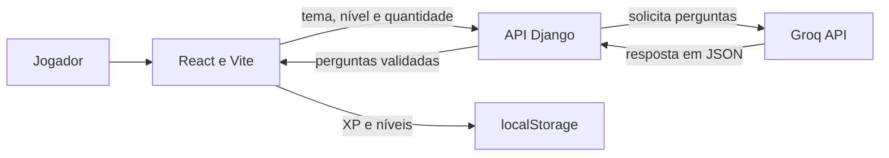

# Quiz Bíblico com IA

Um quiz criado para os jovens e adolescentes que lidero na igreja. A ideia é explorar histórias, personagens e ensinamentos bíblicos de um jeito divertido: escolher uma missão, responder às perguntas e acompanhar a própria evolução.

**[Jogar o quiz](https://quiz-biblico-ia-fios.vercel.app/)**

## O projeto

O Quiz Bíblico com IA combina perguntas geradas pela API da Groq com uma experiência inspirada em jogos. Cada rodada permite escolher um tema, um nível de dificuldade e a quantidade de perguntas. Depois de responder, o jogador vê o gabarito, uma explicação curta e os pontos conquistados.

Criei o projeto para aproximar o estudo bíblico da linguagem dos jovens e adolescentes do grupo que lidero. Ele também se tornou uma oportunidade para praticar integração entre frontend, backend e IA em uma aplicação real.

## O que você encontra no quiz

- **12 temas bíblicos e um modo aleatório** que mistura assuntos diferentes na mesma rodada.
- **Rodadas de 3, 5, 7 ou 10 perguntas**, com quatro alternativas por pergunta.
- **Resposta e explicação imediatas**, revisão completa ao final e indicação de sequência de acertos.
- **100 XP por acerto**, além de um desafio inicial que concede 100 XP uma vez por navegador.
- **Níveis desbloqueáveis**, mapa de progresso responsivo e confetes ao alcançar um novo nível.
- **Página sobre o criador**, com o contexto do projeto.

| Nível | XP necessário para desbloquear |
| --- | ---: |
| Aquecimento | 0 |
| Explorador | 300 |
| Desafio | 900 |
| Lenda | 1.800 |

O XP é salvo no `localStorage` do navegador. Não é preciso criar uma conta, mas o progresso não é sincronizado entre dispositivos e pode ser perdido ao limpar os dados do navegador.

## Tecnologias

| Parte | Tecnologias |
| --- | --- |
| Interface | React, JavaScript, Vite e CSS |
| API | Python, Django e Django REST Framework |
| Geração das perguntas | Groq API (`openai/gpt-oss-120b` por padrão) |
| Progresso | `localStorage` do navegador |
| Desenvolvimento local | Docker Compose |
| Hospedagem | Vercel |

## Como funciona



O backend solicita perguntas à Groq, valida a estrutura da resposta e tenta outro formato JSON quando necessário. Rodadas maiores são geradas em lotes de até três perguntas, com verificação para evitar repetições na mesma rodada. O frontend compara as respostas escolhidas com o gabarito recebido, calcula a pontuação e atualiza o XP.

Essas decisões surgiram de desafios reais do desenvolvimento: respostas da IA fora do formato esperado, limites temporários da API, perguntas repetidas e configuração da comunicação entre frontend e backend no deploy.

> As perguntas são geradas por IA e podem conter imprecisões. Para estudo ou ensino, vale conferir o conteúdo diretamente no texto bíblico.

## Executar localmente

Para usar contêineres, você precisa de [Docker Compose](https://docs.docker.com/compose/) e de uma chave da [Groq](https://console.groq.com/keys).

1. Clone o projeto:

   ```bash
   git clone https://github.com/thaynandias4-collab/quiz-biblico-ia.git
   cd quiz-biblico-ia
   ```

2. Crie o arquivo de ambiente do backend:

   ```bash
   cp backend/.env.example backend/.env
   ```

3. Abra `backend/.env` e substitua `sua_chave_aqui` pelo valor da sua `GROQ_API_KEY`.

4. Inicie os serviços:

   ```bash
   docker compose up --build
   ```

5. Acesse o quiz em **http://localhost:5173**. A API estará em **http://localhost:8000**.

Para encerrar, use `Ctrl+C` e depois `docker compose down`.

### Sem Docker

Em dois terminais, com Python 3.11+ e Node.js 20+ instalados:

```bash
# Terminal 1 — backend, a partir da raiz do projeto
python3 -m venv backend/venv
source backend/venv/bin/activate
pip install -r backend/requirements.txt
cd backend
python manage.py migrate
python manage.py runserver
```

```bash
# Terminal 2 — frontend, a partir da raiz do projeto
cd frontend
npm ci
npm run dev
```

O frontend usa `http://localhost:8000` como endereço padrão da API. Para usar outro backend, configure `VITE_BACKEND_URL` no ambiente do frontend.

## Configuração do deploy

No frontend, defina `VITE_BACKEND_URL` com a URL pública do backend. No backend, configure as variáveis abaixo no ambiente da hospedagem:

| Variável | Finalidade |
| --- | --- |
| `GROQ_API_KEY` | Chave privada da API da Groq |
| `GROQ_MODEL` | Modelo usado para gerar perguntas; opcional |
| `DJANGO_SECRET_KEY` | Chave privada do Django |
| `DEBUG` | Use `False` em produção |
| `DJANGO_ALLOWED_HOSTS` | Domínios aceitos pelo backend, separados por vírgula e sem `https://` |
| `CORS_ALLOWED_ORIGINS` | Origens permitidas para o frontend, separadas por vírgula e com `https://` |

O arquivo `backend/.env` é apenas para uso local e não deve ser enviado ao GitHub. A `GROQ_API_KEY` pertence somente ao backend; variáveis com prefixo `VITE_` ficam acessíveis no código do navegador.

## Sobre o criador

Desenvolvido por **Thaynan Willian Dias** para o grupo de jovens e adolescentes que lidera na igreja. A página inicial do quiz conta um pouco mais sobre o criador e a ideia por trás do projeto.

---

**English summary:** An AI-powered Bible quiz built for a church youth group. Players choose from 12 themes or a random mode, answer Groq-generated questions, earn browser-saved XP and unlock new difficulty levels. Built with React, Vite, Django and Django REST Framework.
